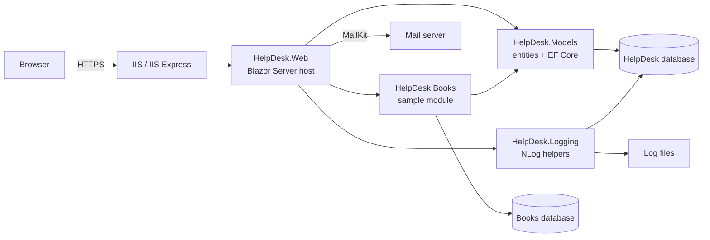
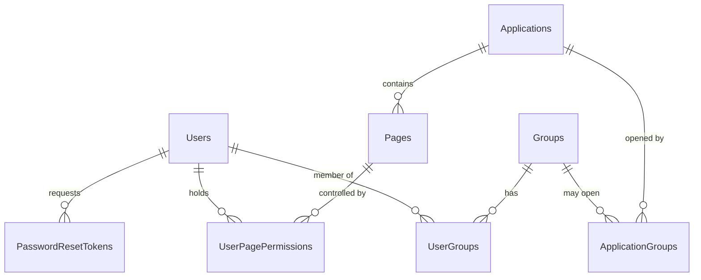
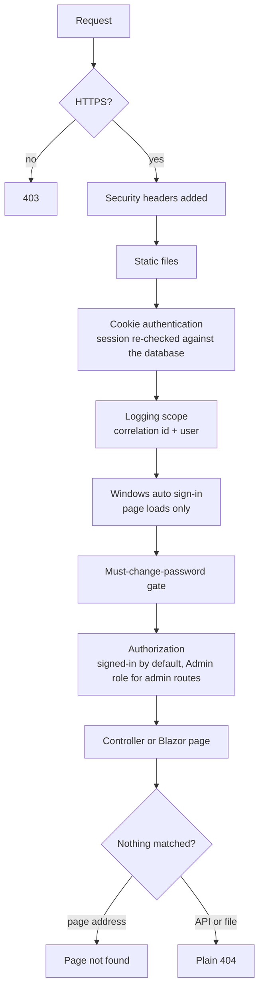
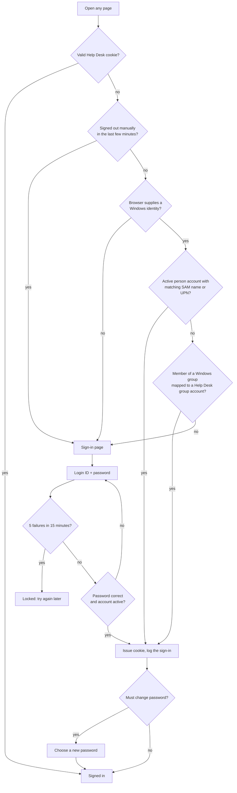
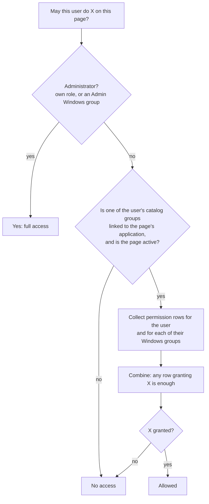
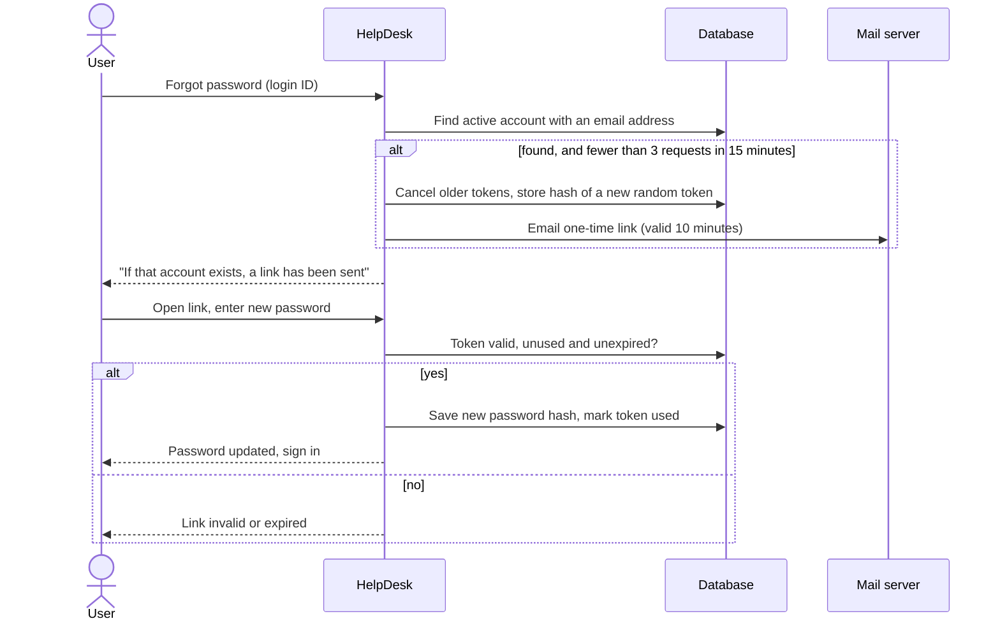

# HelpDesk: overview and process flows

This document explains what the application is made of and how its main processes work. For installation and configuration see the [README](../README.md).

## 1. The idea

HelpDesk is a signed-in portal. Three things define what a person sees:

1. **Who they are**: a row in the `Users` table (a person, or a Windows group that people sign in through).
2. **Which groups they belong to**: groups are linked to applications, and that link decides which applications appear in the menu.
3. **What they may do on each page**: a Create / Read / Update / Delete record per user (or Windows group) per page.

Administrators skip steps 2 and 3: they see and may do everything.

## 2. Building blocks

| Project | Contents |
|---|---|
| `HelpDesk.Web` | Pages (`Components/`), API controllers (`Controllers/`), middleware, services, start-up (`Program.cs`) |
| `HelpDesk.Models` | Entities, `HelpDeskDbContext`, migrations, audit-trail capture |
| `HelpDesk.Books` | A complete module: entities, its own `BooksDbContext`, a grid API, a Blazor page, its script |
| `HelpDesk.Logging` | `EventLogManager`, correlation ids and user context for log entries |
| `HelpDesk.Tests` | Tests that run the real application against throwaway databases |

## 3. Data model

| Table | Meaning |
|---|---|
| `Users` | People **and** Windows groups (`UserType` = User or Group). Holds role (User / Admin), active flag, password hash, optional Windows account name |
| `Groups` | Catalog groups, used only to decide which applications someone can open |
| `Applications` | Entries in the menu. May name an external connection string for a module database |
| `Pages` | Pages of an application: an internal route, an external URL (embedded or new tab), or a separator |
| `ApplicationGroups` | Which groups may open which applications |
| `UserGroups` | Which users (or Windows groups) belong to which catalog groups |
| `UserPagePermissions` | Create / Read / Update / Delete flags per user-or-Windows-group per page |
| `EntityChangeHistory` | The audit trail |
| `NLOG` | Log entries written by NLog |
| `PasswordResetTokens` | Hashed one-time reset tokens with expiry |

## 4. Request pipeline

Every request passes through these steps in order (`Program.cs`):

Points worth knowing:

- **Session re-check.** On every request the cookie's account is looked up. If the account was deleted or deactivated, or the session was logged out, the cookie is rejected. If the role changed, the cookie is updated.
- **A Windows identity alone is not a session.** Under IIS a request can arrive already identified as a Windows account. Until the application has matched it to a Help Desk account and issued its own cookie, the request is treated as anonymous.

## 5. Signing in

- Windows group sign-in: the person has no row of their own. They are signed in as the mapped group account, with that account's catalog groups, permissions and role. If several mapped groups match, their permissions are combined.
- Automatic Windows sign-in happens only on page loads. A submitted form, including the sign-in form, is always handled as submitted.
- Sign-in, sign-out and password changes are written to the log with the login ID.

## 6. What a user may see and do

- The **menu** lists the applications reachable through the user's groups and their active pages.
- **Opening a page** is checked again on the server (a route guard), so typing an address directly does not bypass the menu.
- **Actions** are checked on the server at the moment they happen. Hiding or disabling a button is only a convenience.
- Permissions are **not cached**. A change made by an administrator applies to the user's next action, even on a page they already have open.
- Read is the base permission: removing Read removes Create, Update and Delete.

## 7. Password reset

- The reply is identical whether or not the account exists, and whether or not the email could be sent, so the form cannot be used to discover login IDs.
- Only a hash of the token is stored; the token itself exists only in the email.
- The link's address comes from the request host when `AllowedHosts` restricts it, otherwise from `App:BaseUrl`.

## 8. Administration

| Screen | Purpose |
|---|---|
| Users | People and Windows group accounts: role, active flag, password, Windows account name |
| Groups | Catalog groups |
| Applications | Menu applications, display order, optional external database key |
| Pages | Pages of each application: route, embedded URL, new-tab URL, or separator |
| Application groups | Which groups may open which applications |
| User groups | Which users belong to which groups |
| User page permissions | The Create / Read / Update / Delete matrix |
| Change history | The audit trail, with before/after values |
| NLog | Log viewer with level and category filters |

Safeguards: you cannot delete your own account, the last active administrator cannot be deleted, deactivated or demoted, and names of groups, applications and login IDs must be unique.

## 9. Audit trail and logging

- **Audit trail.** When `HelpDeskDbContext` saves, it records each inserted, changed or deleted user, group, application, page, link and permission in `EntityChangeHistory`, with the acting user and JSON before/after values. Password hashes and reset tokens are excluded.
- **Logging.** NLog writes to rolling files and to the `NLOG` table, and can email alerts. Each request carries a correlation id, so all entries for one request can be found together. The log viewer shows the server's local time.

## 10. Modules

A module is a Razor class library with its own entities, database context, API controller, page and script. `HelpDesk.Books` is the example:

- The host registers it with `AddHelpDeskBooks(connectionString)` and `MapHelpDeskBooks()`, and adds its assembly to the Blazor router.
- The catalog has an application and a page whose route is the module's page (`/user/books/books`).
- The module asks the host what the current user may do through `IBooksAccess`, which the host implements with the central permission rules. The module's page and its data API both use it, so the module cannot drift from the rest of the application.

To start a new module, see [Creating a module](../HelpDesk.Models/Scripts/README.md). A new module should follow the same pattern: define a small access interface, have the host implement it with `IPagePermissionService`, and check it on the server in both the page and the API.

## 11. Security summary

| Area | Measure |
|---|---|
| Transport | HTTPS only; HSTS outside development |
| Session | `Secure`, `HttpOnly` cookie; 60-minute sliding expiry; re-validated on every request; logged-out sessions refused |
| Passwords | Stored as salted hashes (ASP.NET Core Identity hasher); minimum 8 characters; forced change at first sign-in |
| Brute force | Lockout after 5 failed sign-ins, or 5 wrong current passwords, in 15 minutes |
| Reset | Random 256-bit one-time tokens, stored hashed, short-lived; 3 emails per account per 15 minutes |
| Cross-site requests | JSON endpoints require `X-Requested-With`; cookies are `SameSite=Lax` |
| Redirects | Only local addresses are accepted as return targets |
| Headers | `X-Content-Type-Options`, `Referrer-Policy`, and a Content-Security-Policy limiting framing, base URL, form targets and plugins |
| Output | Grid cells escape database text before display |
| Errors | No stack traces outside development; mail failures are logged, not shown |

Known limits: the list of logged-out sessions is held in memory, so an application restart forgets it (a copied cookie could then be reused until it expires, at most 60 minutes). The Content-Security-Policy does not restrict scripts, because the grids use inline handlers.
