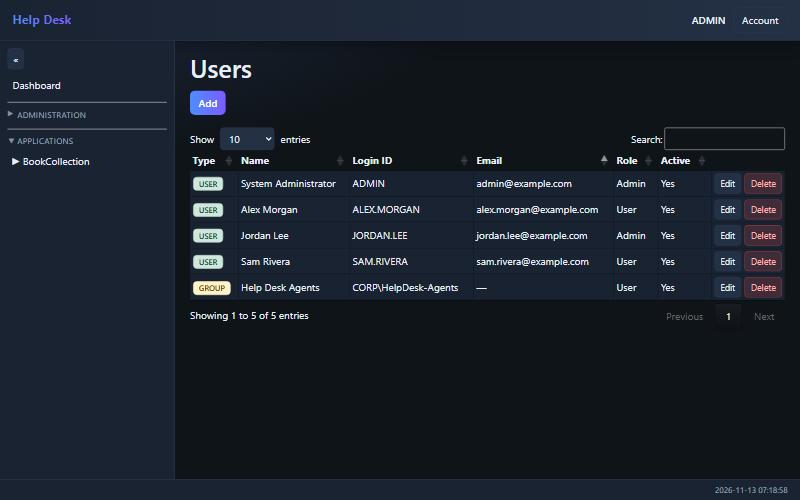
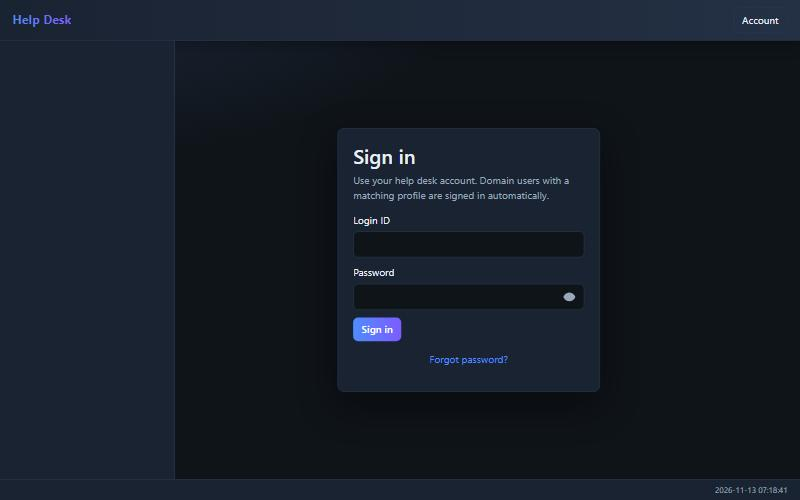
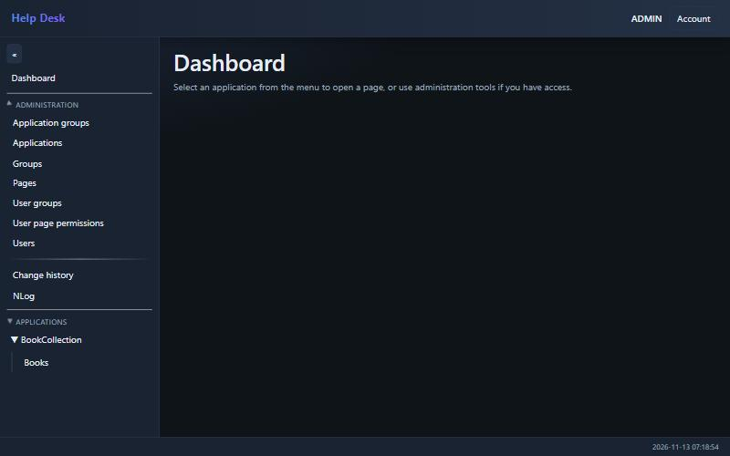
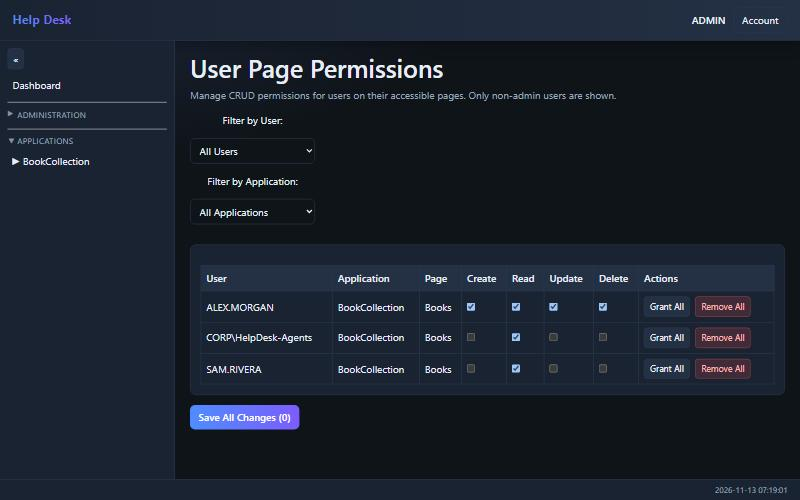
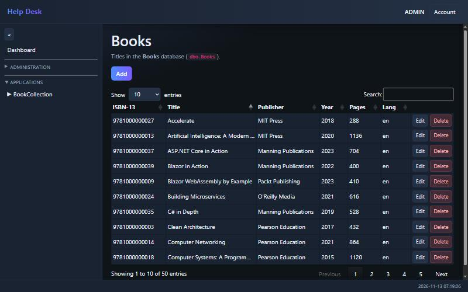
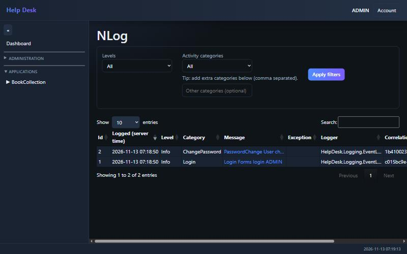

# HelpDesk

A help desk **portal** built with ASP.NET Core 8 and Blazor Server. It gives an organisation one signed-in front door to its internal applications: administrators define applications and pages in a catalog, decide which groups can see them, and grant each user Create / Read / Update / Delete rights page by page.

It is also a working template for a modular Blazor Server line-of-business app, with forms and Windows sign-in, an audit trail, structured logging, and a sample module (**Books**) that shows how to plug in a feature with its own database.



## What it does

- **Sign-in two ways.** Login ID and password, or automatic Windows (Negotiate) sign-in for domain users. Windows *groups* can be mapped to Help Desk accounts so their members need no individual account.
- **Application catalog and menu.** Applications contain pages. A page can be a Blazor route inside the app, an external site embedded in the portal, an external link, or a menu separator. Each user's menu shows only what their groups allow.
- **Page-level permissions.** Per user (or Windows group) and per page: Create, Read, Update, Delete. Administrators have full access. Permissions are checked on the server for every action.
- **Administration screens.** Users, groups, applications, pages, group links, user-group assignments and a permissions matrix, all on sortable, searchable grids.
- **Audit trail.** Every change to users, groups, applications, pages and permissions is recorded with who, when, and before/after values. Password hashes and tokens are never recorded.
- **Logging.** NLog writes to file, to the database, and (optionally) emails alerts. Sign-ins, sign-outs and password changes are logged, and there is a built-in log viewer.
- **Account security.** Forced password change on first sign-in, password reset by emailed one-time link, lockout after repeated failures, idle timeout.
- **Modules.** Features live in separate class libraries. `HelpDesk.Books` is the worked example, and a PowerShell script scaffolds new ones.

## Screenshots

| | |
|---|---|
|  Sign in |  Dashboard with the administrator's menu |
|  Page-level permissions |  The Books sample module |
|  Users, including a mapped Windows group |  Log viewer |

## Documentation

| Document | What it covers |
|---|---|
| [Overview and process flows](Docs/HelpDesk-Functionality-Overview.md) | How the pieces fit together: sign-in, permissions, request pipeline, password reset, auditing |
| [HelpDesk.Books](HelpDesk.Books/README.md) | The sample module and how it is wired in |
| [Creating a module](HelpDesk.Models/Scripts/README.md) | Scaffolding a new module with `New-HelpDeskModule.ps1` |
| [Migration naming](Docs/EF-Migrations-Naming.md) | Conventions for EF Core migrations |

## Solution layout

| Project | Purpose |
|---|---|
| `HelpDesk.Web` | The Blazor Server host: pages, controllers, middleware, services |
| `HelpDesk.Models` | Entities, `HelpDeskDbContext`, EF Core migrations, module scaffolding script |
| `HelpDesk.Books` | Sample module: Books catalog with its own database, API and page |
| `HelpDesk.Logging` | Logging helpers (correlation ids, user context) on top of NLog |
| `HelpDesk.Tests` | Automated tests (xUnit, bUnit) that run the real application |

Technology: .NET 8, Blazor Server (interactive server rendering), Entity Framework Core 8 with SQL Server, cookie and Negotiate authentication, NLog, MailKit, jQuery DataTables.

## Getting started

### Prerequisites

- [.NET 8 SDK](https://dotnet.microsoft.com/download/dotnet/8.0)
- SQL Server (any edition; LocalDB is enough for development and is required by the tests)
- Visual Studio 2022 with IIS Express. The web project is configured for IIS in-process hosting, so run it with the **IIS Express** profile rather than `dotnet run`.

### 1. Clone and restore

```
git clone <repo-url>
cd HelpDesk
dotnet restore
```

### 2. Set the connection strings

Secrets are kept out of the repository. In development they come from [User Secrets](https://learn.microsoft.com/aspnet/core/security/app-secrets):

```
cd HelpDesk.Web
dotnet user-secrets set "ConnectionStrings:HelpDesk" "Server=.;Database=HelpDesk;Integrated Security=true;TrustServerCertificate=true;MultipleActiveResultSets=true"
dotnet user-secrets set "ConnectionStrings:Books" "Server=.;Database=Books;Integrated Security=true;TrustServerCertificate=true;MultipleActiveResultSets=true"
```

### 3. Create the databases

- **HelpDesk database.** Created and migrated automatically at start-up when `App:DbInit` is `true`. It is `true` in `appsettings.Development.json` and `false` by default everywhere else.
- **Books database.** Not created automatically. Run the scripts in `HelpDesk.Books/Models/Scripts` (`HelpDesk-BooksInitial.sql`, then optionally `SeedBooks50.sql` for sample data).

### 4. Configure email (optional)

Needed only for password-reset emails and error alerts:

```
dotnet user-secrets set "Smtp:Direct:Host" "<smtp-host>"
dotnet user-secrets set "Smtp:Direct:User" "<smtp-user>"
dotnet user-secrets set "Smtp:Direct:Password" "<smtp-password>"
dotnet user-secrets set "Smtp:AlertTo" "<alert-address>"
dotnet user-secrets set "Smtp:NormalTo" "<notification-address>"
```

`Smtp:Mode` selects the `Direct` or `Standard` profile. If mail cannot be sent, the application logs the failure and carries on.

### 5. Run

Open `HelpDesk.sln` in Visual Studio and start the **IIS Express** profile (`https://localhost:44343`).

On first start with an empty database the application creates one administrator:

- Login ID: `ADMIN`
- Password: the value of `App:InitialAdminPassword` (`ChangeMe!123` unless you change it)

You must choose a new password at first sign-in. Change `App:InitialAdminPassword` before deploying anywhere real.

## Running the tests

```
dotnet test HelpDesk.Tests
```

The suite starts the real application in memory against two throwaway LocalDB databases, which it creates and drops itself. Email is captured, never sent. It covers sign-in, lockout, password change and reset, every route's access rules, permissions, sessions, Windows sign-in, the Books module, validation and the audit trail.

## Security model in brief

- Every route requires a signed-in user unless explicitly marked anonymous. Admin pages and admin data require the `Admin` role.
- The session cookie is `Secure`, `HttpOnly`, and re-checked on every request: deleting, deactivating or demoting an account takes effect on its next request, and a logged-out session cannot be replayed.
- Permissions are read fresh from the database on every check, so revoking access is immediate.
- HTTPS only. Baseline security headers are sent on every response.
- JSON endpoints require an `X-Requested-With` header (cross-site request forgery defence).
- Sign-in and current-password checks lock out after 5 failures in 15 minutes. Password-reset emails are limited to 3 per account per 15 minutes.
- The application will not let you delete, deactivate or demote the last active administrator.

Details and diagrams are in the [overview](Docs/HelpDesk-Functionality-Overview.md).

## Deployment (IIS)

1. Publish: `dotnet publish HelpDesk.Web -c Release -o ./publish`
2. Install the [ASP.NET Core Hosting Bundle](https://dotnet.microsoft.com/download/dotnet/8.0) on the server.
3. Create an IIS site on the `publish` folder with an application pool set to **No Managed Code**.
4. For Windows sign-in, enable both **Windows Authentication** and **Anonymous Authentication** on the site. Anonymous is needed for the sign-in page; the application itself decides who is signed in.
5. Supply settings through environment variables or `appsettings.Production.json`. Never deploy development secrets.

| Environment variable | Setting |
|---|---|
| `ConnectionStrings__HelpDesk` | HelpDesk database |
| `ConnectionStrings__Books` | Books database |
| `Smtp__Direct__Host`, `Smtp__Direct__User`, `Smtp__Direct__Password` | Mail server |
| `App__BaseUrl` | Public address of the site |
| `App__InitialAdminPassword` | First-run administrator password |

### Production checklist

- [ ] `AllowedHosts` lists the real host name(s), not `*`
- [ ] `App:BaseUrl` is the public address (used in password-reset emails when `AllowedHosts` is `*`)
- [ ] `App:InitialAdminPassword` changed, and the administrator has signed in and set a new password
- [ ] `App:DbInit` decided: `true` to migrate at start-up, or apply migrations yourself
- [ ] Mail settings tested
- [ ] NLog file path and database target are valid on the server
- [ ] If the grid scripts in `wwwroot/js` change, bump their `?v=` value in `Components/App.razor` so browsers reload them

## Configuration reference

Settings under `App` in `appsettings.json`:

| Key | Default | Meaning |
|---|---|---|
| `DbInit` | `false` | Apply migrations and seed data at start-up |
| `BaseUrl` | `https://localhost:5001` | Public address used for reset links when the host header cannot be trusted |
| `InitialAdminLoginId` | `ADMIN` | Login ID of the first-run administrator |
| `InitialAdminPassword` | `ChangeMe!123` | Its initial password (must be changed at first sign-in) |
| `PasswordResetTokenHours` | `1` | Lifetime of reset links requested by email address (links requested by login ID last 10 minutes) |
| `WindowsAutoLoginChallenge` | `true` | Offer Windows sign-in to browsers on page loads |
| `SuppressWindowsAutoLoginMinutes` | `1` | After a manual sign-out, how long to hold off automatic Windows sign-in |
| `EnableWindowsGroupIntegration` | `true` | Map Windows groups to Help Desk group accounts |
| `LoginRateLimit:MaxAttempts` | `5` | Failed attempts before lockout |
| `LoginRateLimit:WindowMinutes` | `15` | Lockout window |

## Database migrations

Migrations for the main database live in `HelpDesk.Models/Migrations`:

```
cd HelpDesk.Models
dotnet ef migrations add <MigrationName> --startup-project ../HelpDesk.Web
```

See [migration naming](Docs/EF-Migrations-Naming.md).

## License

[MIT](LICENSE)
